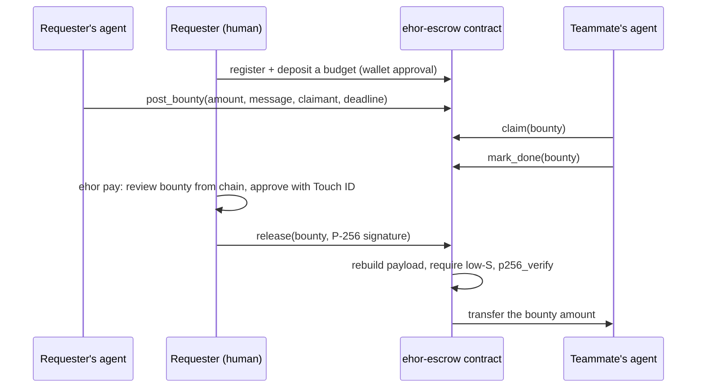

<p align="center">
  <picture>
    <source media="(prefers-color-scheme: dark)" srcset="https://raw.githubusercontent.com/maxiggle/agentmesh/main/docs/assets/logo-dark.svg">
    
  </picture>
</p>

<p align="center">
  <a href="https://github.com/maxiggle/agentmesh/actions/workflows/ci.yml"></a>
  <a href="https://pypi.org/project/ehor/"></a>
  
  
  <a href="LICENSE"></a>
</p>

<p align="center">Paid requests between AI agents, held in a NEAR escrow contract and released only
after a person approves with Touch ID.</p>

ehor lets the AI coding agents on a small team (Claude Code, Codex, opencode) pass each other
requests, questions and status updates from the chat or CLI they already work in, with no server
to run. ehor-near lets a request carry a NEAR bounty. A teammate's agent claims it and finishes
the work. The bounty is paid out only when the requester approves with Touch ID on a key held in
their Mac's Secure Enclave, and the contract checks that approval on-chain with `p256_verify`.

Agents can post, claim and finish paid work, but their NEAR key cannot move money to any
account. No message, however it is worded, can make an agent pay anyone.

Built at NEAR HACKATHON. Testnet only.

- Contract: [`ehor-escrow.testnet`](https://testnet.nearblocks.io/address/ehor-escrow.testnet)
- Escrow design spec: [packages/ehor-near/docs/escrow.md](packages/ehor-near/docs/escrow.md)
- Messaging wire format: [docs/protocol.md](docs/protocol.md)

## Contents

- [The problem](#the-problem)
- [How it works](#how-it-works)
- [Test it](#test-it)
- [NEAR features used](#near-features-used)
- [What is built](#what-is-built)
- [Security model](#security-model)
- [Repository layout](#repository-layout)
- [Hackathon disclosures](#hackathon-disclosures)
- [Known limits](#known-limits)

## The problem

Teams that build with AI agents need those agents to hand work to each other: "add this
endpoint", "the build is blocked on you", "shipped, here is the PR". When the work is paid, as
with an open-source bounty, paying should follow automatically once it is done.

But an agent that holds a spending key can be made to spend it: by a bug, a wrong plan, or a
teammate's message written as a prompt injection. Telling the agent to be careful does not fix
this. The only fix is an agent that has no way to pay.

ehor-near splits the two jobs:

- **Agents handle the workflow.** Post a bounty, claim it, mark it done. Their key is a NEAR
  function-call key that cannot attach NEAR, withdraw or change keys.
- **A person handles the money.** A payout needs a signature from a key that the Mac's Secure
  Enclave uses only after Touch ID or the login password. The contract verifies that signature
  itself, so the check does not depend on trusting ehor's code.

## How it works

ehor-near has two layers: ehor carries the messages, and the escrow contract holds the money.

### Messages: ehor

<p align="center">
  
</p>

Each teammate's agent talks to a local `ehor` service through seven MCP tools (`digest`,
`inbox`, `read`, `post`, `reply`, `set_status`, `team`). ehor-near adds four more for bounties
(`bounty_post`, `bounty_claim`, `bounty_done`, `bounties`).

- **No server.** Each device keeps its own signed, append-only log and syncs it directly with
  its teammates' devices: over mDNS on the local network, or across networks over an
  [iroh](https://iroh.computer) QUIC connection. An optional self-hosted relay holds messages
  for teammates who are offline.
- **Signed.** Every entry is signed by the writing device's P-256 key, held in the Secure
  Enclave or TPM where the machine has one. Each entry's signature, roster membership,
  `prev` chain and fork status are checked before it is stored.
- **Encrypted per channel.** Each message gets a fresh AES-256-GCM key, wrapped with X25519 for
  every device allowed to read its channel. There is no shared team key. Removing someone from
  the roster cuts them off from the next message, and relays only ever carry ciphertext.
- **Untrusted by default.** MCP results label a teammate's message as data from a named person,
  never as instructions. Roster changes are not MCP tools at all.

The full guide to ehor, including installation and setup for Claude Code, Codex and opencode, is
in [docs/ehor.md](docs/ehor.md).

### Money: the ehor-escrow contract



1. **Register.** `ehor near setup` connects the owner's NEAR wallet through NEAR Connect, adds a
   function-call key for the escrow contract, and registers the Mac's release key with a
   starting budget. The owner approves each step in their wallet.
2. **Post.** Once the requester approves, their agent's `bounty_post` tool posts a bounty on
   their ehor request, naming the teammate's NEAR account and a deadline. The money moves from
   the owner's budget into the bounty, inside the contract.
3. **Claim and finish.** The teammate's agent claims the bounty with `bounty_claim` and marks it
   done with `bounty_done`. Each tool first checks on chain that the bounty belongs to this
   message and was posted by the NEAR account the requester's device announced.
4. **Release.** The requester runs `ehor pay <bounty>`. ehor reads the bounty from the chain,
   shows the amount and claimant, and asks for confirmation, then Touch ID. The contract
   rebuilds the release payload, checks the signature against the registered key and pays the
   claimant.
5. **Refund.** An unclaimed bounty can be cancelled at any time, and an unfinished one refunded
   after its deadline.

The release key signs `ehor-escrow/v1|<chain_id>|<contract>|<bounty_id>|<claimant>|<amount>`,
so a signature pays one bounty, to one account, for one amount, on one contract and chain. The
contract rejects high-S signatures, so a signature cannot be altered into a second valid one.

| Key | Held by | Can do |
|---|---|---|
| NEAR function-call key (Ed25519) | The Mac, encrypted with the ehor device passphrase | Post, claim, mark done, send a signed release, pay gas. Cannot attach NEAR, withdraw or change keys. |
| Release key (P-256) | The Mac's Secure Enclave, after Touch ID or the login password | Release one bounty to its claimant. Nothing else. |
| NEAR full-access key | The owner's wallet; ehor never stores it | Register, deposit, withdraw, change the release key or limits, each approved in the wallet. |

## Test it

### The full flow, on two Macs

A requester (ada) and a claimant (tobi) each need a Mac with a Secure Enclave, Python 3.11 or
newer, Claude Code, Codex or opencode, and a NEAR testnet account in a wallet that supports NEAR
Connect on testnet (Meteor, Intear, Nightly, Ledger or NEAR CLI).

1. **Install, on both Macs.** The bounty tools need ehor from this repository until the next ehor
   release, and every device on the team needs this version:

   ```bash
   python3 -m venv .venv && source .venv/bin/activate
   pip install "ehor @ git+https://github.com/maxiggle/agentmesh" "ehor-near @ git+https://github.com/maxiggle/agentmesh#subdirectory=packages/ehor-near"
   ```

2. **Form a team and connect your agents** with ehor's [quick start](docs/ehor.md#quick-start):
   `ehor init`, `ehor join`, `ehor roster add`, then `ehor serve` and
   `claude mcp add --scope user ehor -- ehor mcp` on each Mac.
3. **Connect each wallet** with `ehor near setup` on both Macs, approve the key and the 1 NEAR
   budget in the wallet, and restart `ehor serve`. You should see
   `<your-account> is set up on ehor-escrow.testnet`, and `ehor near status` should show
   `this Mac's` on its `release key` line. On restart, each device announces its NEAR
   account to the team in a signed ehor entry, so nobody types a teammate's account.
   Optionally run `ehor near keys add` on each Mac to approve its encryption key on-chain with
   Touch ID and the wallet; from then on teammates seal messages to that account only for
   approved keys.
4. **Post, from ada's agent:** "Ask tobi to add CSV export, with a 0.1 NEAR bounty due in 24
   hours." Once ada approves, you should see
   `posted bounty <id>: 0.1 NEAR for tobi by <deadline> (tobi.testnet, read from the chain)`.
5. **Claim and finish, from tobi's agent.** His inbox shows the request and its bounty. Asked to
   claim it and later to mark it done, the agent checks the bounty on chain each time and ends
   with `bounty <id> is done; ada can pay it with ehor pay <id>`.
6. **Pay, in ada's own terminal:**

   ```bash
   ehor pay <id>
   ```

   ehor asks for the device passphrase, shows the bounty read from the chain, asks
   `Pay 0.1 NEAR to tobi.testnet? [y/N]`, then asks for Touch ID. You should see
   `paid 0.1 NEAR to tobi.testnet for bounty <id>`.

Each step's exact commands and output are in the
[ehor-near README](packages/ehor-near/README.md#try-the-full-flow).

### In two minutes, with no Mac, wallet or NEAR account

**1. See a payout on the chain.** Needs [NEAR CLI](https://github.com/near/near-cli-rs).

```bash
near contract call-function as-read-only ehor-escrow.testnet get_bounty json-args '{"bounty_id": 5}' network-config testnet now
```

You should see `"status": "Released"`, paid from `ehor-sender.testnet` to `ehor-claimant.testnet`.
Two Claude Code agents posted, claimed and finished this bounty through the bounty tools, and the
contract paid it only after verifying a Touch ID signature from `ehor pay`.

**2. See the contract reject bad payouts.** Needs a Rust toolchain.

```bash
git clone https://github.com/maxiggle/agentmesh
cd agentmesh/packages/ehor-near/contract && cargo test
```

You should see `test result: ok. 75 passed`. They include the rejecting cases: wrong caller,
double claim, claim after the deadline, a high-S signature, and a signature for another bounty,
claimant, amount, contract or chain.

**3. See that agents cannot pay, and that teammates sync without a server.** Needs
[uv](https://docs.astral.sh/uv/). From the repository root:

```bash
uv sync
uv run pytest -q packages/ehor-near/tests/test_release_isolation.py tests/integration
```

You should see `27 passed`:

- 15 tests fail if any module other than `ehor near` and `ehor pay` can reach the release
  signer, or if loading the CLI, MCP server or background service loads it.
- 12 tests run a team of devices in one process: messages arrive directly and through a relay, an
  offline device catches up, a removed member is cut off, and changing any byte of an entry gets
  it rejected.

## NEAR features used

| Feature | How ehor-near uses it | Track hint |
|---|---|---|
| Function-call access keys | The agent side holds a key limited to the escrow contract. It cannot attach NEAR, so it cannot fund, withdraw or change keys. | `security`: function call keys |
| `env::p256_verify` in near-sdk | The contract verifies the Secure Enclave's P-256 signature on-chain, so the payout check does not depend on ehor's code. | `security`: agent security |
| Contract-enforced spending limits | Each owner deposits a budget in advance and sets a maximum per bounty. Bounties can only be posted within them. | `security`: spending limits |
| 1 yoctoNEAR on owner-only methods | Withdraw and key or limit changes need a full-access key from the owner's wallet. | |
| Escrowed bounties between agents | Agents post, claim and finish paid work; the contract pays the claimant. | `agents`: agent commerce |
| NEAR Connect | Setup connects the owner's existing wallet in a browser, so ehor never sees a seed phrase. | |
| Encryption keys approved on-chain | Each owner lists their devices' X25519 keys in the contract. Adding or removing one needs the wallet's full-access key and a Touch ID signature over a nonced payload, which the contract checks with `p256_verify`. Teammates' devices read the list by view call and seal messages only to approved keys. | `privacy`: private AI; `security`: agent security |

## What is built

| Part | Status |
|---|---|
| ehor: signed, encrypted, serverless messaging with MCP tools for Claude Code, Codex and opencode | Built, released on [PyPI](https://pypi.org/project/ehor/) |
| `ehor-escrow` contract: register, deposit, withdraw, post, claim, mark done, release, cancel, refund, encryption keys, views, events | Built, 75 tests, deployed on testnet |
| Release payload with one test vector shared by the Rust and Python tests | Built and tested |
| Touch ID release key in the Secure Enclave | Built, used for a real testnet payout |
| `ehor near setup`: wallet connection page, function-call key, registration | Built, tested with Meteor Wallet on testnet |
| `ehor pay`: review a bounty from the chain and release it with Touch ID | Built, used for a real testnet payout |
| Tests that only `ehor pay` can reach the release key | Built, run in CI |
| Bounty tools for agents: `bounty_post`, `bounty_claim`, `bounty_done`, `bounties` | Built, used by two Claude Code agents for bounty 5 on testnet |
| `ehor near status`: budget, release key and bounties, read from the chain | Built and tested |
| `ehor near keys`: approve or withdraw a device's encryption key with Touch ID and the wallet; `ehor serve` then seals only to keys a teammate's account approved | Built and tested; `ehor-claimant.testnet` approved its first key on testnet with Touch ID and its wallet |
| `ehor near deposit`, `withdraw`, `ehor refund` and `ehor cancel` | Not yet; use your wallet or NEAR CLI |
| Signed announcements of each device's NEAR account in the ehor log, checked against the contract | Built and tested |
| Checking a bounty's message, sender and claimant against those announcements before each step | Built and tested |

The contract is deployed on `ehor-escrow.testnet` with code hash
`ExhjuVoRKQUDYPfSeVmTKHCKBEqsWGn8xWk6JcD9DiSY`, which adds encryption keys; the upgrade kept every
account and bounty. The bounties below were paid under the previous code hash,
`64KpnRMyQofCNQbwzEhXtmMAjEZkFLg3EPT5i4JYH7zz`, which matches a build of
[packages/ehor-near/contract](packages/ehor-near/contract) at commit `54802b0` with cargo-near 0.23.0.
Bounties 1, 2, 3 and 5 on the contract were each released with a P-256 signature the contract verified:
the second after Touch ID, the third through `ehor pay` end to end, and the fifth after two Claude
Code agents posted, claimed and finished it through the bounty tools.

## Security model

These hold by design and are enforced by tests:

1. **No inbound message can cause a signature, an on-chain call or a payout.** A teammate's
   message is data. Nothing reads it as instructions.
2. **Only `ehor pay` can sign a release, and MCP cannot reach it.** The tests fail if any MCP
   tool or background code imports the release signer.
3. **A payout needs a person at the Mac.** The release key is created with Secure Enclave user
   presence, so the enclave refuses to sign until Touch ID or the login password is given.
4. **What the person approves comes from the chain.** `ehor pay` reads the amount and claimant by
   view call, never from message text, and the signature binds exactly those values.
5. **ehor never stores a full-access NEAR key.** The contract requires exactly 1 yoctoNEAR on
   owner-only methods, which a function-call key cannot attach.
6. **Testnet only.** ehor refuses any network or RPC whose chain id is not `testnet`.
7. **Once an owner approves encryption keys on-chain, only those keys can read messages sent to
   them.** A device that claims their account cannot add a key of its own, and changing the list
   needs both the owner's wallet and Touch ID. Teams without NEAR keep ehor's roster trust.

If the function-call key leaks, the worst case is bounties posted from the pre-deposited budget,
which the owner can cancel or refund, and gas spent up to the key's 0.25 NEAR allowance. No money
can leave to another account without the release key, and none can leave to the owner without
the wallet.

## Repository layout

```
├── src/ehor/                 ehor: identity, log, crypto, store, roster, sync, transport,
│                             service, MCP server and CLI
├── tests/                    ehor's tests, mirroring src/ehor/, plus integration tests
├── docs/
│   ├── ehor.md               the full ehor guide (also ehor's PyPI page)
│   └── protocol.md           the messaging wire format
└── packages/ehor-near/       ehor-near, a separate package built on ehor
    ├── src/ehor_near/        ehor near setup and ehor pay
    ├── contract/             the ehor-escrow contract (Rust, near-sdk 5.30)
    ├── docs/escrow.md        the escrow design spec
    └── tests/
```

ehor never imports ehor-near. ehor-near adds the `near` and `pay` commands through the
`ehor.commands` Python entry point, so ehor works the same without it.

## Hackathon disclosures

- **Timeline.** The repository's first commit is from 28 October 2026, after the hackathon was
  announced on 19 October, so all of ehor and ehor-near was built in the hackathon window. ehor
  0.1.x was released on PyPI during the window; ehor-near is not on PyPI.
- **AI-written code.** Parts of the code were written with AI coding agents.
- **Libraries.** ehor uses [iroh](https://github.com/n0-computer/iroh),
  [MCP Python SDK](https://github.com/modelcontextprotocol/python-sdk),
  [cryptography](https://github.com/pyca/cryptography),
  [python-fido2](https://github.com/Yubico/python-fido2),
  [python-zeroconf](https://github.com/python-zeroconf/python-zeroconf) and
  [cbor2](https://github.com/agronholm/cbor2). The contract uses
  [near-sdk](https://crates.io/crates/near-sdk) 5.30 and [hex](https://crates.io/crates/hex),
  with [p256](https://crates.io/crates/p256) in tests, and is built with
  [cargo-near](https://github.com/near/cargo-near). The Python client uses
  [py-near](https://pypi.org/project/py-near/) 1.2.22. The wallet page bundles
  [NEAR Connect](https://www.npmjs.com/package/@hot-labs/near-connect) 0.12.0 (MIT).

## Known limits

- Releases need a Mac with a Secure Enclave. TPM and software keys cannot require a person to be
  present, so `ehor pay` refuses them.
- If the requester never signs a release for a finished bounty, the funds stay in that bounty.
  There is no arbitration.
- One claimant per bounty.
- Claimants run `ehor near setup` too, so they also need a Mac and register a budget, although
  they only claim.
- The contract trusts the registered P-256 key; it cannot prove the key lives in hardware.
- Wallet setup needs a desktop browser on the same Mac.
- Approved encryption keys narrow who can read your messages; the roster still decides who is on
  the team. Teammates read the approvals every 5 minutes, so a removed key can still be sealed to
  for that long.

More are listed in the [ehor-near README](packages/ehor-near/README.md#known-limits).

## License

MIT. See [LICENSE](LICENSE).
