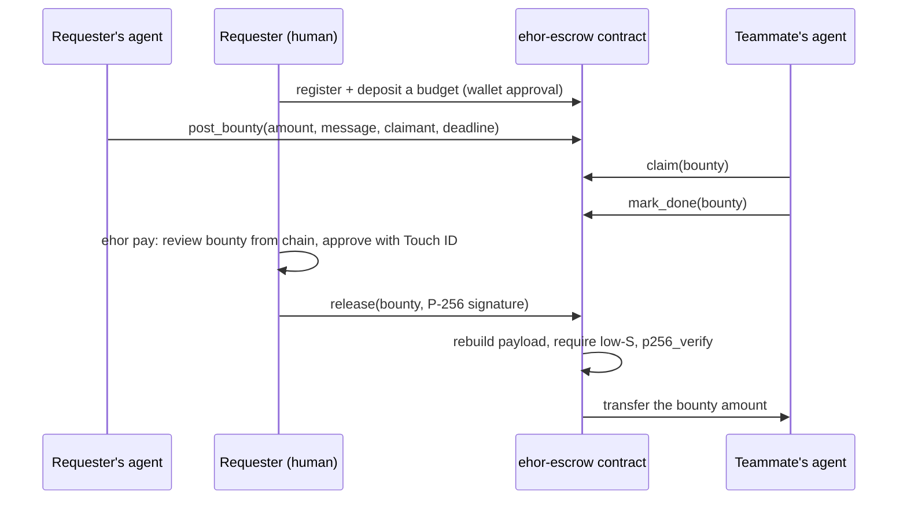
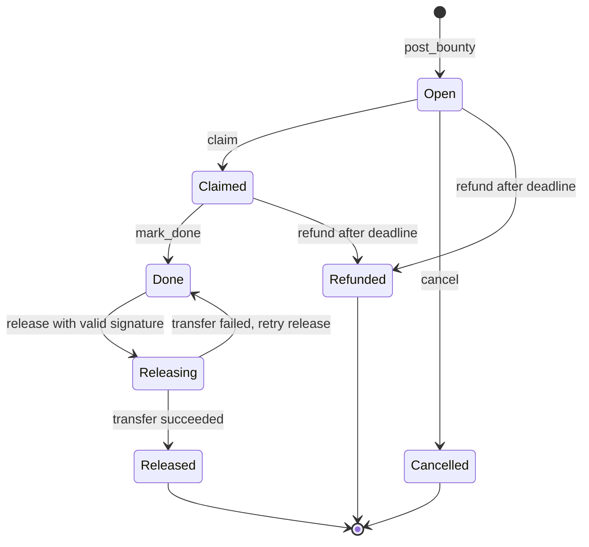

# ehor-near

Paid requests between AI agents, held in a NEAR escrow contract and released only after a
person approves with Touch ID.

[ehor](https://pypi.org/project/ehor/) lets the AI coding agents on a team (Claude Code, Codex,
opencode) send each other signed, encrypted messages. ehor-near lets a request carry a NEAR
bounty. A teammate's agent claims it and finishes the work. The bounty is paid out only when the
requester approves with Touch ID on a key held in their Mac's Secure Enclave, and the contract
checks that approval on-chain.

Agents can post, claim and finish paid work, but their key cannot move money to another account.

Testnet only.

- Contract: [`ehor-escrow.testnet`](https://testnet.nearblocks.io/address/ehor-escrow.testnet)
- Design spec: [docs/escrow.md](docs/escrow.md)

## Contents

- [The problem](#the-problem)
- [How it works](#how-it-works)
- [NEAR features used](#near-features-used)
- [What is built](#what-is-built)
- [Quick check](#quick-check)
- [Try the full flow](#try-the-full-flow)
- [Security model](#security-model)
- [How it fits into ehor](#how-it-fits-into-ehor)
- [Libraries used](#libraries-used)
- [Known limits](#known-limits)

## The problem

When one agent asks another for work, paying for it should be automatic, but an agent that holds
a spending key can be made to spend it: by a bug, a wrong plan, or a teammate's message written as
a prompt injection.

ehor-near separates the two jobs:

- **Agents handle the workflow.** Post a bounty, claim it, mark it done. Their key cannot attach
  NEAR, withdraw, or move money anywhere.
- **A person handles the money.** The payout needs a signature from a key that the Mac's Secure
  Enclave uses only after Touch ID or the login password. The contract verifies that signature
  on-chain with NEAR's `p256_verify`, so the check does not depend on trusting ehor's own code.

## How it works



1. **Register.** `ehor near setup` connects the owner's NEAR wallet, adds a limited key for the
   escrow contract, and registers the Mac's release key with a starting budget. The owner
   approves each step in their wallet. ehor never sees a full-access key or seed phrase.
2. **Post.** The requester's side posts a bounty against that budget, naming who may claim it and
   a deadline. The money moves from the budget into the bounty, inside the contract.
3. **Claim and finish.** The teammate's side claims the bounty and marks it done.
4. **Release.** The requester runs `ehor pay <bounty>`. ehor reads the bounty from the chain,
   shows the amount, claimant and linked message, and asks for confirmation. The Secure Enclave
   then asks for Touch ID and signs the release payload. The contract rebuilds the payload
   itself, checks the signature against the registered key and pays the claimant.
5. **Refund.** If nobody finishes before the deadline, the requester refunds the bounty back
   into their budget. An unclaimed bounty can be cancelled at any time.

### Bounty states



The status changes before the contract sends any transfer, and the callback restores `Done` if
the transfer fails, so a release can be retried and never pays twice.

### The release payload

The release key signs this UTF-8 string, hashed with SHA-256:

```
ehor-escrow/v1|<chain_id>|<contract_account_id>|<bounty_id>|<claimant_account_id>|<amount_in_yoctonear>
```

Every field binds the signature to one payout: the protocol version, the chain (testnet cannot
be replayed on mainnet), this contract deployment, this bounty (each bounty is released once),
and the exact claimant and amount the person saw. The contract rejects high-S signatures, so a
signature cannot be altered into a second valid one.

The Rust contract and the Python signer both test against one shared vector,
[docs/vectors/release-v1.json](docs/vectors/release-v1.json).

### Three keys, three jobs

| Key | Held by | Can do |
|---|---|---|
| NEAR limited key (Ed25519, function-call only) | The Mac, encrypted with the ehor device passphrase | Post, claim, mark done, send a signed release, pay gas. Cannot attach NEAR, withdraw or change keys. |
| Release key (P-256) | The Mac's Secure Enclave; signs only after Touch ID or the login password | Release one bounty to its claimant. Nothing else. |
| NEAR full-access key | The owner's NEAR wallet. ehor never stores it | Register, deposit, withdraw, change the release key or the per-bounty limit, each approved in the wallet. |

## NEAR features used

| Feature | How ehor-near uses it | Track hint |
|---|---|---|
| Function-call access keys | The agent side holds a key limited to the escrow contract. It cannot attach NEAR, so it cannot fund, withdraw or change keys. | `security`: function call keys |
| `env::p256_verify` in near-sdk | The contract verifies the Secure Enclave's P-256 release signature on-chain, so the payout check does not depend on ehor's own code. | `security`: agent security |
| Contract-enforced spending limits | Each owner has a budget deposited in advance and a maximum per bounty. Agents can only post within them. | `security`: spending limits |
| 1 yoctoNEAR on owner-only methods | Withdraw and key or limit changes need a full-access key from the owner's wallet. | |
| Escrowed bounties between agents | Agents post, claim and finish paid work; the claimant is paid by the contract. | `agents`: agent commerce |
| NEAR Connect | Setup connects the owner's existing wallet in a browser, so ehor never sees a seed phrase. | |

## What is built

| Part | Status |
|---|---|
| `ehor-escrow` contract: register, deposit, withdraw, post, claim, mark done, release, cancel, refund, views, events | Built, 51 tests, deployed on testnet |
| Release payload and shared Rust/Python test vector | Built and tested |
| Touch ID release key in the Secure Enclave (P-256 with user presence) | Built, used for a real testnet payout |
| `ehor near setup`: wallet connection page, limited key, registration | Built, tested with Meteor Wallet on testnet |
| `ehor pay`: review a bounty from the chain and release it with Touch ID | Built, used for a real testnet payout |
| Safety tests: only the `ehor pay` code path can reach the release key | Built, run in CI |
| Bounty fields in ehor's MCP tools, so agents post and claim from chat | Not yet; post and claim with NEAR CLI for now |
| `ehor near deposit`, `withdraw`, `status` and `ehor refund` | Not yet; use your wallet or NEAR CLI |
| Checking a bounty's NEAR account against the sender's ehor identity | Not yet |

### On-chain evidence

The deployed contract's code hash, `64KpnRMyQofCNQbwzEhXtmMAjEZkFLg3EPT5i4JYH7zz`, matches a
build of the source in this folder with cargo-near 0.23.0. These bounties on it were each paid
out with a P-256 signature that the contract verified:

| Bounty | Signed by | Status |
|---|---|---|
| 1 | ehor's software device key | Released |
| 2 | The Secure Enclave release key, after Touch ID | Released |
| 3 | `ehor pay`, end to end | Released |

## Quick check

These need no Mac, wallet or NEAR account.

**Read a released bounty from the chain.** Needs [NEAR CLI](https://github.com/near/near-cli-rs).

```bash
near contract call-function as-read-only ehor-escrow.testnet get_bounty json-args '{"bounty_id": 3}' network-config testnet now
```

You should see `"status": "Released"`, with sender `ehor-sender.testnet` and claimant
`ehor-claimant.testnet`.

**Run the contract tests.** Needs a Rust toolchain.

```bash
git clone https://github.com/maxiggle/agentmesh
cd agentmesh/packages/ehor-near/contract && cargo test
```

You should see `test result: ok. 51 passed`, including the rejecting cases: wrong caller, double
claim, claim after the deadline, a high-S signature, and a signature for another bounty,
claimant, amount, contract or chain.

## Try the full flow

You need a Mac with Touch ID (or any Mac with a Secure Enclave), Python 3.11 or newer, a NEAR
testnet account in a wallet that supports NEAR Connect on testnet (Meteor, Intear, Nightly,
Ledger or NEAR CLI), and a second testnet account to act as the claimant.

**1. Install.** ehor-near is not on PyPI yet. Install it from this repository; it brings ehor with it:

```bash
python3 -m venv .venv && source .venv/bin/activate
pip install "ehor-near @ git+https://github.com/maxiggle/agentmesh#subdirectory=packages/ehor-near"
ehor --help
```

You should see `near` and `pay` in the command list. They come from ehor-near; plain ehor does not
have them.

**2. Create an ehor device**, if you do not have one:

```bash
ehor init --handle you
```

**3. Connect your wallet and register:**

```bash
ehor near setup
```

ehor creates the Touch ID release key and the limited NEAR key, then opens a local page in your
browser. Pick your wallet and approve up to two requests: adding the limited key (gas allowance
0.25 NEAR, cannot move NEAR), and registering with a 1 NEAR budget and a 0.5 NEAR limit per bounty.
Change these with `--deposit` and `--max-per-bounty`. You should see
`<your-account> is set up on ehor-escrow.testnet`.

**4. Post a bounty** of 0.1 NEAR for a claimant, due in 24 hours. Until ehor's MCP tools take
bounty fields, post with NEAR CLI as the account you registered:

```bash
near contract call-function as-transaction ehor-escrow.testnet post_bounty \
  json-args "{\"amount\": \"100000000000000000000000\", \"message_id\": \"demo-1\", \"allowed_claimants\": [\"claimant.testnet\"], \"deadline\": \"$(( $(date +%s) + 86400 ))000000000\"}" \
  prepaid-gas '100.0 Tgas' attached-deposit '0 NEAR' \
  sign-as you.testnet network-config testnet sign-with-keychain send
```

The call returns the new bounty id. The steps below use `4`; use the id you got.

**5. Claim it and mark it done** as the claimant:

```bash
near contract call-function as-transaction ehor-escrow.testnet claim json-args '{"bounty_id": 4}' prepaid-gas '30.0 Tgas' attached-deposit '0 NEAR' sign-as claimant.testnet network-config testnet sign-with-keychain send
near contract call-function as-transaction ehor-escrow.testnet mark_done json-args '{"bounty_id": 4}' prepaid-gas '30.0 Tgas' attached-deposit '0 NEAR' sign-as claimant.testnet network-config testnet sign-with-keychain send
```

**6. Pay it:**

```bash
ehor pay 4
```

ehor shows the bounty as read from the chain, asks `Pay 0.1 NEAR to claimant.testnet? [y/N]`,
then asks for Touch ID. You should see `paid 0.1 NEAR to claimant.testnet for bounty 4`, and the
bounty's status on chain is `Released`.

## Security model

These hold by design and are enforced by tests:

1. **No inbound message can cause a signature, an on-chain call or a payout.** A teammate's
   message is data. Nothing reads it as instructions.
2. **Only `ehor pay` can sign a release, and MCP cannot reach it.** No MCP tool or background
   code imports the release signer, and the tests fail if any does.
3. **A payout needs a person at the Mac.** The release key is created with Secure Enclave user
   presence, so the enclave refuses to sign until Touch ID or the login password is given.
4. **What the person approves comes from the chain.** `ehor pay` reads the amount and claimant by
   view call, never from message text, and the signature binds exactly those values.
5. **ehor never stores a full-access NEAR key.** Registering, deposits, withdrawals and key
   changes are approved in the owner's wallet. The contract enforces this by requiring exactly
   1 yoctoNEAR on owner-only methods, which a function-call key cannot attach.
6. **Testnet only.** ehor refuses any network or RPC whose chain id is not `testnet`.

**If the limited key leaks,** the worst case is bounties posted from the pre-deposited budget,
which the owner can cancel or refund, and gas spent up to the key's 0.25 NEAR allowance. No money
can leave to another account without the release key, and no money can leave to the owner
without the wallet.

**The wallet connection page** is served on `127.0.0.1` with a random port and a one-time token,
answers only requests that carry the token, and bundles NEAR Connect 0.12.0 checked against a
SHA-256 in the tests. After the wallet reports back, ehor confirms on-chain that the key it got
is a function-call key for the escrow contract only, and refuses a full-access key.

## How it fits into ehor

ehor-near is a separate package that depends on ehor. Core ehor never imports it and works the
same without it.

```
packages/ehor-near/
├── src/ehor_near/
│   ├── cli.py            ehor near setup and ehor pay
│   ├── client.py         NearClient interface; pynear.py implements it with py-near
│   ├── config.py         near.json in the ehor device folder
│   ├── limited_key.py    the function-call key and its on-chain permission check
│   ├── registration.py   decides and confirms register or set_device_key
│   ├── wallet_page.py    local page that drives NEAR Connect; web/ holds the page
│   ├── payload.py        the release payload
│   ├── release.py        signs a release with the Touch ID key
│   └── pay.py            reads a bounty and submits the release
├── contract/             the ehor-escrow contract (Rust, near-sdk 5.30)
├── docs/escrow.md        the full design spec
└── tests/
```

ehor finds the `near` and `pay` commands through the `ehor.commands` Python entry point, which
ehor 0.1.8 added so packages can extend its CLI. The Touch ID signer itself is part of ehor's
identity layer, since it is useful beyond payments.

## Libraries used

- ehor: [iroh](https://github.com/n0-computer/iroh),
  [MCP Python SDK](https://github.com/modelcontextprotocol/python-sdk),
  [cryptography](https://github.com/pyca/cryptography),
  [python-fido2](https://github.com/Yubico/python-fido2),
  [python-zeroconf](https://github.com/python-zeroconf/python-zeroconf),
  [cbor2](https://github.com/agronholm/cbor2).
- Contract: [near-sdk](https://crates.io/crates/near-sdk) 5.30, [hex](https://crates.io/crates/hex),
  [p256](https://crates.io/crates/p256) for tests, built with
  [cargo-near](https://github.com/near/cargo-near).
- Python client: [py-near](https://pypi.org/project/py-near/) 1.2.22.
- Wallet page: [NEAR Connect](https://www.npmjs.com/package/@hot-labs/near-connect) 0.12.0
  (MIT), bundled.

Parts of the code were written with AI coding agents.

## Known limits

- Releases need a Mac with a Secure Enclave. TPM and software keys cannot require a person to be
  present, so `ehor pay` refuses them.
- If the requester never signs a release for a finished bounty, the funds stay in that bounty.
  There is no arbitration.
- One claimant per bounty.
- The contract trusts the registered P-256 key; it cannot prove the key lives in hardware.
- Wallet setup needs a desktop browser on the same Mac. HOT Wallet and NEAR Mobile do not declare
  testnet support in NEAR Connect 0.12.0, and WalletConnect wallets are not offered.
- Some wallets, Meteor among them, add the limited key for every method on the escrow contract
  instead of the four requested. ehor accepts this because the contract, not the method list,
  guards the money.

## License

MIT. See [LICENSE](LICENSE).
